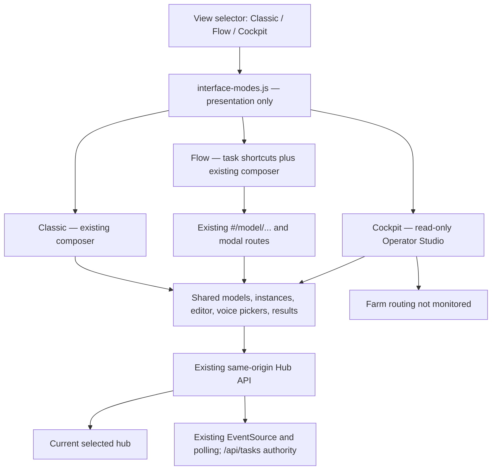
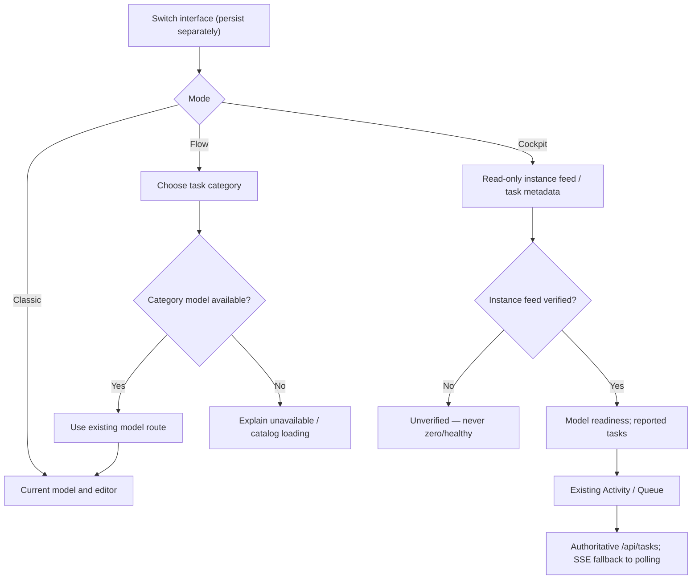

> Recovery note: this design is implemented on the private source review branch; historical branch/checkpoint statements below describe the archived design. See docs/qa-three-interface-modes.md for current scope.\n\n# Three interface modes — isolated source-only design

> Branch `feat/three-interface-modes`, based on locally committed
> `326d512` (Operator Studio). This does not merge, deploy or replace
> existing worktrees.

## Shared application architecture

## Workflow and degradation

## Boundaries and expected behavior

- **Classic** is the default for absent, invalid or unknown `hub-interface-mode`. Switching
  never resets selected model, active instance, text draft, results, history or queue.
- **Flow** resolves a configured model or a READY local instance, and explains
  when catalog-only models still need setup instead of silently switching.
- **Flow** is task-first navigation, not a second synthesis form or duplicated API.
  TTS/ASR selection uses existing model routes; Voices and Models use the current
  library and sidebar. Missing category models produce a localized explanation.
- **Failure recovery:** optional Cockpit import failure shows a localized alert
  and retry. Its read-only metrics are hidden until the chunk loads; retry
  does not reset editor or task state. Local task changes emit an event for
  Cockpit to refresh its session timeline, without additional network polling.
- **Cockpit** reuses committed `326d512`: current hub's instance feed and session-local
  task metadata. It does **not** claim farm-global readiness, control remote
  hosts, synthesize audio or introduce routing endpoints.
- Theme (`hub-theme`), language (`hub-lang`), model selection
  (`hub-model`), and interface (`hub-interface-mode`) remain separate.
- The source-only service-worker version advances from v1 to v2 to keep cached
  assets internally consistent at any separately approved future deployment.
- No new network calls, timers or frontend framework. The optional cockpit
  module remains lazy; mode CSS is local and precached alongside the module.
- Non-active content stays mounted but becomes inert. Mode buttons are native,
  labeled, `aria-pressed`, keyboard-operable and at least 44px high/wide.
- Preserve the original CSP, SSE resource safety, PWA update policy,
  privacy-safe activity feed, bilingual i18n and deployment topology.

## Pre-merge and deployment gates

1. Review against concurrent dirty Operator Studio worktree and
   `feat/operator-studio-density-ux2`; do not copy local changes silently.
2. Run synthetic-only e2e at 320/390/768/1024/1366/1920 and both locales;
   check screen-reader/focus behavior, stale/empty states, editor persistence.
3. Check service-worker precache and no-build module import inventory; review
   failure states, CSP and version-aware deployment assets.
4. Rebase/resolve conflicts against main and draft PRs #154, #156, #159.
5. Owner separately approves any GitHub push, hosted CI, merge or deployment.
   Current CI triggers on all pushes and PRs and was deliberately not used.

### Reconciliation: mode navigation and chronology

Flow's ready-model fallback treats a READY instance as available only while
the local instance feed is loaded and non-stale, consistent with Cockpit's
unverified-feed indicators. The editor-heading focus transfer follows route
application, and does not run after a newer mode/route/model selection. The
Cockpit task list shows local creation metadata and known final durations
without task payloads or additional requests/timers.
