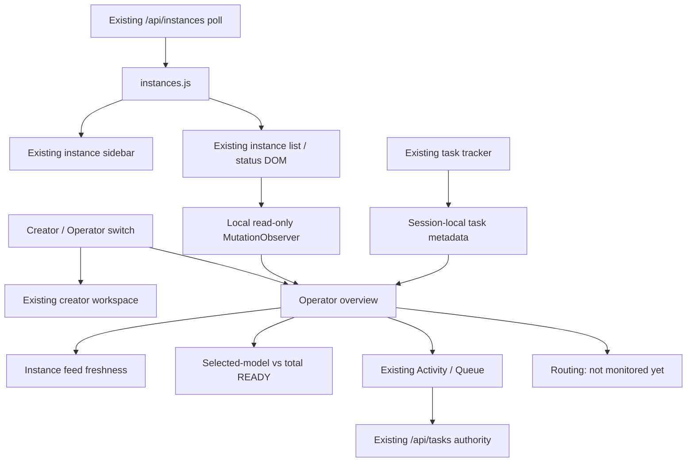

> Recovery note: this design is implemented on the private source review branch; historical branch/checkpoint statements below describe the archived design. See docs/qa-three-interface-modes.md for current scope.\n\n# Operator Studio Hybrid — source-only architecture

> Historical Direction C foundation at commit `326d512`; the current three-mode interface architecture and default/locale semantics are documented in [interface-modes.md](interface-modes.md). This module is reused as Cockpit; the earlier Creator / Operator labels have been superseded.

Direction C is an **additive read-only view**, not a new backend or an inference interface.

## Invariants

- The creator view retains the established model selection, input controls, routing, API requests, and results. The switch never changes the selected model or active instance.
- The operator view does **not** issue new HTTP requests, start polling, or infer overall hub health from an individual model. It reuses existing instance polling and only reads local task metadata.
- A stale, missing or never-loaded instance feed displays **unverified** status (not zero or healthy); no source of truth for farm/failover health exists in this initial slice, so routing is explicitly labelled *not monitored*.
- The recent-task timeline is **session-local** and excludes prompt text, audio and results. The existing Activity / Queue remains the authoritative route to server task data.
- The view switch uses native buttons with `aria-pressed`, a visible label and focus retention. Non-active content is hidden and inert. A new feature is lazy-loaded via the existing JavaScript module architecture; the Service Worker precache covers the chunk.
- English/Chinese parity is preserved through global mode labels and the feature-local bilingual dictionary, which loads on demand like Activity / Queue. The operator stylesheet also loads on demand, with both assets present in Service Worker precache. Styling respects narrow screens and reduced motion; there is no new framework, external asset, endpoint, or deployment setting.

## Future approval gates

Verified farm/fanout routing metadata, historical global timeline, model failover controls, and cross-host health require separately reviewed API contracts and further synthetic validation before implementation. They are deliberately absent from this slice.
